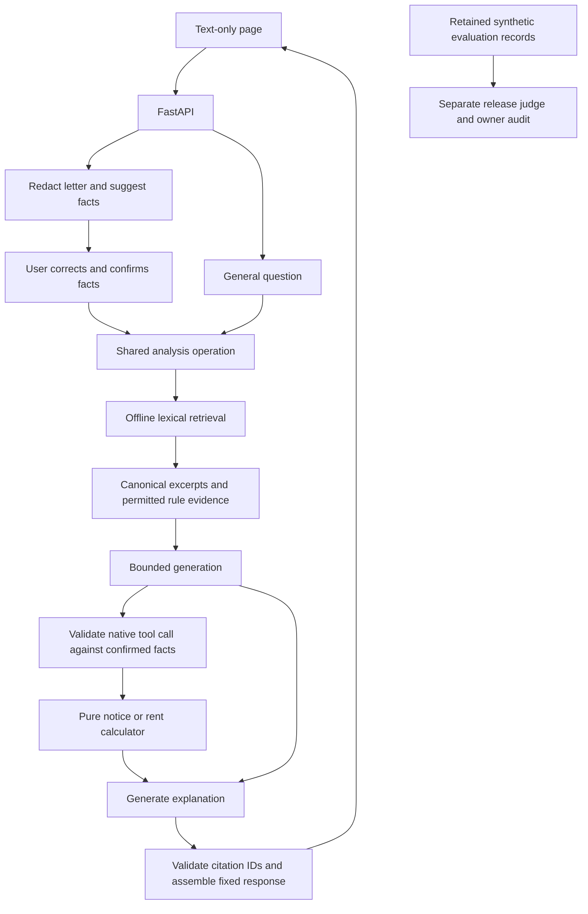

# Rent Navigator

Rent Navigator provides general information about ordinary Ontario rent increases and notice timing. It combines a versioned official-source corpus, lexical retrieval, typed calculator tools, confirmed facts and cited explanations. It supports general questions and an anonymized letter-to-confirmation flow.

> Independent project; not affiliated with the Government of Ontario or the Landlord and Tenant Board. General legal information, not legal advice. Rules as of 2026-09-21; results depend on confirmed facts. For advice, consult a licensed Ontario lawyer or paralegal.

The snapshot date is the earliest actual UTC fetch date in the [retained corpus manifest](results/october-release/source-50190/src/rent_navigator/corpus/manifest.json), separate from statutory consolidation periods. The corpus does not update automatically.

## Public service and smoke

The service is at [rent-navigator.onrender.com](https://rent-navigator.onrender.com). The [post-reset verification](results/october-release/public-letter-smoke-v1.0.3-source/post-reset-verification.json) records HTTP 200 for `/healthz` and `/` at `2026-10-22T21:27:32.180088Z`, with source `50190c8173c8f36193be15b4f857df8b724094fa` in health and the page footer. This is the measured source, `v1.0.3-source`.

The [public letter smoke](results/october-release/public-letter-smoke-v1.0.3-source/verification.json) ran once with both POST responses returning HTTP 200. Extraction and confirmed analysis shared an attempt ID with distinct trace IDs. The explanation described the 60-day notice failure and the 2.1% guideline ceiling of $2042.00 against $2048.00 proposed rent, with the required sections 116 and 120 citations.

The same receipt records a known instruction limitation: the answer added a correct $6.00 difference beyond the supplied money-display strings. The specified smoke checks passed; strict prompt compliance and general explanation quality are not established.

The [accounting receipt](results/october-release/public-letter-smoke-v1.0.3-source/accounting.json) records **US$0.022208** actual serving cost, complete usage, a **US$0.081** reservation forecast and a **US$0.30/day** test cap. The owner confirmed returning `DEMO_DAILY_USD` to `0` with Save and deploy after the test, and confirmed Auto-Deploy off. These settings are owner-confirmed, not observable from free GET responses. The page and health remain available while generation is gated.

The [smoke verification](results/october-release/public-letter-smoke-v1.0.3-source/verification.json) records **17.262141 seconds** for the HTTP flow including transport and local validation. This is separate from collection serving latency. No retry or judge call was used for this smoke.

## Owner release-scope revision, 2026-10-12

The owner adopted the revised release scope in [PROJECT-SPEC.md §12](PROJECT-SPEC.md#12-owner-release-scope-amendment-2026-10-12) and [CONTRACTS.md §11](CONTRACTS.md#11-owner-release-scope-amendment-2026-10-12). This is a scope revision, not acceptance of the original definition of shipped. The original target claims remain unchanged in PROJECT-SPEC.md.

At the initial revision checkpoint there was no deployed demo, activated baseline or release collection. Those statements describe that checkpoint. Later collection, audit and deployment observations retain their own source identities and do not retroactively change it.

Deferred, not deleted: the live gate as a required check, the permit/environment/ledger protocol, the 22 fixed diagnostics, per-run independent review, baseline activation and the anchor wire. Baseline activation and the retrieval floor remain pending.

Private calibration, admission and ledger work stops. Existing evidence remains preserved. No new private artifact, protocol review, candidate helper, admission preparation or ledger event is required beyond recording actual authorized paid commands, caps and costs. Historical funding and gate designs do not authorize current execution.

The later conditional calibration decision and the actual collection, owner audit and scan are disclosed below. They do not establish a passed calibration gate, an activated baseline or the original full-spec shipment criteria.

## How it works



The application uses Python, uv, FastAPI/Uvicorn, Pydantic, the Anthropic SDK and SQLite FTS5. The serving actor is `claude-haiku-4-5-20251001`; release judging uses `claude-sonnet-5`. Dependencies and runtime configuration are retained in the [source configuration bundle](results/october-release/source-50190/).

General questions receive fixed rule references plus the original ranked retrieval seeds. Confirmed notice and rent requests require a native tool call whose name and arguments match the confirmed request exactly. The server executes `notice_deadline_check` or `rent_increase_check`, then supplies the actual result and applicable rule evidence for the explanation. Invalid calls or output fail without repair retries.

The tools preserve independently available dates and amounts when other facts are unknown. A passing status means only that the checked conditions passed, not that an increase is lawful or a notice valid. The tools do not adjudicate disputed scope, exemption evidence, form completeness or actual delivery contents.

Production statements must cite available canonical chunks. The server resolves URLs, headings and snapshot dates. This establishes citation provenance and coverage, not semantic support. Exact money-display context does not validate the meaning of generated prose.

The comparison arm uses the same facts, tools, actor, budgets and deadline without external reference passages. Its citations are optional. Both arms constrain supplied IDs to available evidence IDs. The comparison measures the whole grounded system and citation policy; it does not isolate the causal effect of query ranking. Fixed references do not improve ranked-seed retrieval metrics.

## Reporting scope

The approved reporting sentence is retained exactly:

> exact-match tool evals and security fixtures run in CI as required checks and block regressions; LLM-as-judge scoring runs at release (calibration agreement m of 13; human audit agreement k of 32)

Measured calibration agreement is **8 of 13 against proposed expectations that were not independently reviewed**, as recorded in the [current measurement summary](results/october-release/k2-calibration-measurement-1/summary.json). Only the named J04/J06 s4 factual and citation fields received owner review, with their labels upheld; other labels remain proposed. The registered calibration gate failed and remains failed.

Human audit agreement is **30 of 32** first-repetition outputs, with **20 of 21** additional flagged outputs agreeing, as recorded in [owner-record.json](results/october-release/owner-audit-run-3-record/owner-record.json).

Every output was read against the gold expected fields, required claims, the retained tool result, the cited and canonical passages and the judge rubric. An assisted first pass over all 53 outputs ran three read-only review passes: overall classification; citation support and policy; and an adversarial pass over every overall agree. Each item was classified agree, disagree or unsure with a written reason. The owner decided every item any pass marked disagree or unsure, covering 19 outputs and 26 decisions, and read the four N04/R06 first-repetition outputs in full. Every value in the record is the owner's decision. Overall agreement means agreement with the judge's task-success classification; citation support does not enter task success. No provider call was made for this audit.

The reviewed set is selected, not representative of all outputs. Full-arm results remain as judged. Owner corrections are shown only over matching reviewed denominators and are not propagated to unreviewed repetitions.

## Measured results as judged

The [run-3 plan](results/october-release/run-3/collection/plan.json), [manifest](results/october-release/run-3/collection/manifest.json) and [summary](results/october-release/run-3/collection/summary.json) retain 160 measured attempts: 16 approved development cases, both arms and five repetitions, with 80 attempts per arm. Six warmups are retained separately. The serial schedule uses seed 42 and alternating arm order. No failed attempt or unfavorable repetition is removed.

| Original judge result | Production | Same-tool baseline |
|---|---:|---:|
| Task success | 64/80, 80% | 55/80, 68.75% |
| Successes by repetition | 12, 13, 13, 13, 13 | 11, 11, 11, 10, 12 |
| Repetition rate range | 75%-81.25% | 62.5%-75% |
| Tool-case success | 39/50 | 44/50 |
| Q&A success | 25/30 | 11/30 |
| Answered outputs | 80 | 80 |
| Incorrect attempts | 16 | 25 |
| Refusals / errors | 0 / 0 | 0 / 0 |
| Factual-hallucination flags / answered | 11/80 | 16/80 |

Task success requires exact assertions, required claims, factual support and absence of false passes or policy violations. Citation support is separate. Production had 24/80 citation failures in the same summary. Baseline citation compliance is not imposed; its zero citation-failure counter is not a citation-success claim.

The cases were approved before scoring but reused during development. Repetitions from this small fixed dataset are not independent population samples.

## Owner audit beside original grades

The [selection](results/october-release/owner-audit-run-3/selection.json) contains 53 outputs: 32 first-repetition outputs plus 21 additional factual-hallucination flags. There were 27 flags in total, with six already in the first-repetition sample. The set contains 24 production and 29 baseline outputs.

The matched-scope counts below come from [owner-record.json](results/october-release/owner-audit-run-3-record/owner-record.json):

| Reviewed scope | Production judged | Production audited | Baseline judged | Baseline audited |
|---|---:|---:|---:|---:|
| First repetition | 12/16 | 11/16 | 11/16 | 10/16 |
| Entire selected set | 12/24 | 11/24 | 11/29 | 11/29 |

No corrected whole-arm total is asserted. Citation agreement was 29 agree, six disagree and 18 not applicable because the output cited nothing; policy agreement was 53 agree and zero disagree. These are agreement counts, not citation-support or safety pass rates.

The [owner decisions](results/october-release/owner-audit-run-3-record/owner-decisions.csv) record three overall disagreements:

- `run-3-q05-baseline-repeat-0`: judge success, owner incorrect because invented form titles conflict with the corpus titles.
- `run-3-q05-production-repeat-0`: judge success, owner incorrect because the explanation misstated the section 6.1 boundary and omitted the residential-occupation qualification.
- `run-3-r04-baseline-repeat-3`: judge incorrect, owner supported because the factual sentence was supported by the supplied result.

The [owner notes](results/october-release/owner-audit-run-3-record/README.md) record inconsistent grades on identical text and, for citation comparisons, the same cited passages:

- R04 baseline s4: factual supported in repeats 0, 1, 2 and 4; unsupported in repeat 3.
- R04 baseline s3: citation supported in repeat 0; unsupported in repeat 3.
- N02 production s3: citation supported in repeats 0 and 4; unsupported in repeats 1, 2 and 3.

Original grades remain unchanged beside the owner decisions. The publication record contains only the four owner-approved decision files and a new subset inventory; assisted-pass provenance remains separately retained, as explained in the [results index](results/README.md#owner-record-copy-and-subset-inventory).

## Targeted computed-field scan

The committed [rule](results/run-3-targeted-scan/RULE.md) and [scan result](results/run-3-targeted-scan/scan.json) cover every retained judge-successful N04/R06 answer across both arms and all repetitions. Frozen rule `computed-value-availability-v1` examined 15 eligible answers and all 62 statements among 20 target rows. It found zero candidate statements and zero flagged answers.

| Case and arm | As judged, all repetitions | As audited, actual reviewed subset | Scan-eligible answers |
|---|---:|---:|---:|
| N04 production | 0/5 | 0/5 | 0 |
| N04 baseline | 5/5 | 1/1 | 5 |
| R06 production | 5/5 | 1/1 | 5 |
| R06 baseline | 5/5 | 1/1 | 5 |

Audited denominators come from [owner-record.json](results/october-release/owner-audit-run-3-record/owner-record.json); coverage comes from scan.json. The rule links finite field aliases directly to availability predicates and checks that same observed `actual_tool_result` field. It does not use expected results as authority. Finite vocabulary and context guards can miss paraphrases or overflag unusual language. Zero candidates is not semantic clearance.

No additional owner reads were added. The scan-specific `owner_reads_complete` and `audited_verdicts` fields remain null. The owner read the four first-repetition N04/R06 outputs in full; the scan does not imply review of unflagged repetitions.

## Judge calibration and limits

The measurement used grade-only wire policy 8, `shared_id_keyed_grades`, and packet policy 3; anchor wire 6 remains retained history. Configuration and historical representation details are indexed in [results/README.md](results/README.md#historical-wire-and-review-checkpoints).

The [collection manifest](results/october-release/run-3/collection/manifest.json) and [current calibration measurement](results/october-release/k2-calibration-measurement-1/summary.json) share judge hash:

```text
23cd495fad0dcc45be0f63018a6f921b152a76fe5a28fc0b2fc4e8d658f38ef8
```

The measurement, at actual source and runner `fb9517c308bc4c29a54ec77b6ca05a5adf4cfd6e`, decoded all 14 votes, agreed on 123/132 fields and matched 8/13 complete proposed expectations. Only J04 and J06 were fail-to-pass flips; the full R04 validator passed. This was a measurement after a failed gate, not a gate pass or official collection.

Collection ran under this actual configuration by the owner's conditional decision after the gate failed. Only the named J04/J06 s4 factual/citation fields were owner-reviewed with labels upheld; other labels remain proposed and not independently reviewed. J04, J06, J10, J13 and R04 informed rubric clarification, so their agreement is in-sample.

The subsequent assisted owner audit is an out-of-sample judge check relative to those calibration packets, not a held-out product benchmark or representative estimate over all outputs. The judge remains frozen unless a new failure type receives an owner ruling.

## Latency and cost

The [run-3 summary](results/october-release/run-3/collection/summary.json) reports production nearest-rank serving latency of **13.153 seconds p50** and **16.181 seconds p95**, rounded from `13153.39164598845 ms` and `16180.895197001519 ms` over all 80 production attempts.

The boundary is the warm-local shared serving operation, including extraction where applicable, preflight, retrieval, tool execution, generation, validation and trace completion. It excludes HTTP/browser transport, human confirmation delay and judging. These are not public-network or cold-start timings.

At fixed project rates, the same summary records:

| Cost category, USD | Production | Baseline |
|---|---:|---:|
| Measured serving | 1.513300 | 0.502575 |
| Serving cost per 100 attempts | 1.891625 | 0.62821875 |
| Separate judging | 3.464800 | 3.250928 |

Serving cost per hundred is `100 × actual measured serving token cost / measured attempts`, including extraction. Endpoint summaries and provider-call details are not added twice.

Warmup serving cost was US$0.075489. Total run spending at project rates was US$8.807092: measured serving US$2.015875, warmups US$0.075489 and judging US$6.715728. Historical attempts, calibration and the public smoke are separate. Hosting spend is unmeasured and excluded. These figures are not a provider invoice or account-balance claim. Missing usage remains unknown with its full reservation, never free.

The [manifest](results/october-release/run-3/collection/manifest.json) records the local ARM64 measurement image:

```text
sha256:c9293278a2a7237288098296f5b4a8e9a375c66cbf76dfab88a30fdeacda9273
```

Render's image architecture and digest have not been independently measured. The local image does not prove the deployed image's identity.

## Collection history and stopping rules

All original attempts are retained separately in the [results index](results/README.md).

- [Run-1](results/october-release/run-1/collection/manifest.json) is incomplete and nonreportable after its judge output-limit stop, with no headline.
- [Dry-run-2](results/october-release/dry-run-2/dry-run/manifest.json) failed on `usage.speed="standard"`; its historical actual cost remains unknown with the full reservation.
- [Run-2](results/october-release/run-2/collection/manifest.json) passed completion verification but is unusable as a headline comparison because of baseline citation-schema asymmetry.
- [Run-3](results/october-release/run-3/collection/manifest.json) is the complete post-correction collection used above, not an infrastructure-only whole-batch retry.

Collection ran locally in the recorded Docker image under a flat cap, not the CI permit path. The [batch ledger](results/october-release/run-3/batch-ledger.json) records a US$43.00 cap and US$42.26040 forecast, distinct from actual spending.

The stopping rule ends collection after five consecutive serving-side `provider_error` or `deadline_exceeded` attempts, resetting on another result; judge-side failures stop immediately. Warmups participate in the counter without entering scored denominators. [Run-3 rows and metadata](results/october-release/run-3/collection/) contain no such execution failures in either arm, so both denominators contain zero such failed attempts. Incorrect answers remain counted.

## Historical unresolved holds

These are historical reservations with unresolved usage, using their UTC recording dates, not known actual charges. Their source and funding context are recorded in [results/README.md](results/README.md#historical-funding-and-deferred-protocol) and CONTRACTS.md §10.

| UTC date | Unresolved hold | Purpose |
|---|---:|---|
| 2026-09-27 | US$0.08200 | Historical judge calibration; failed third generation after two completed votes. |
| 2026-10-03 | US$0.13192 | Fresh judge calibration; failed J01 generation. |
| 2026-10-08 | US$0.13192 | Fresh judge calibration; failed J01 generation. |
| 2026-10-09 | US$0.13192 | Fresh judge calibration; failed J01 generation. |
| 2026-10-10 | US$0.13192 | Fresh judge calibration; failed J01 generation. |
| Total | **US$0.60968** | Actual charges unknown. |

The owner ruled these internal holds written off outside any permit for this cycle. This did not settle provider charges, rewrite receipts, release a historical reservation inside a permit or authorize more work. Actual charges remain unknown, never zero. Historical records and ledger events 43, 44 and 45 remain unchanged.

At that historical checkpoint, known incurred spending was US$0.729081 and cumulative owner-confirmed provider funding was US$75. The latter reflected the October 1 confirmation of an additional US$20, with allocations of US$62 to development/CI/measurement, US$9 to protected demo and US$4 to unallocated provider reserve. Hosting US$14 and separate contingency US$6 made the historical total cash allocation US$95. These are historical confirmations and planning amounts, not current incurred spending, a queried account balance or an execution grant.

Automatic replenishment remains disabled. New missing usage remains `actual_cost=null`, `usage_complete=false`, with its full reservation; the historical write-off is not a general missing-usage exemption.

## CI and unexercised checks

Required checks this cycle are `checks`, `docker` and `offline-eval`, with strict required checks and administrator enforcement under the recorded release policy. This documentation does not claim a new inspection or change of repository settings.

`live-eval-gate` is not required this cycle, and the live-eval environment reviewer rule is not restored.

The [committed workflow](results/october-release/source-50190/.github/workflows/ci.yml) uses `github.event_name == 'pull_request' && vars.LIVE_EVAL_ENABLED == 'true'` for `live-eval-plan` and `always() && vars.LIVE_EVAL_ENABLED == 'true'` for `live-eval-gate`. The scope revision does not authorize changing environments, secrets or repository variables.

The retrieval floor remains pending, and retrieval and answer-quality regressions are not gated.

Only the exact-match tool evals, deterministic security fixtures and schema/hash/approval checks block evaluation regressions in CI. Missing, skipped, cancelled or stale prerequisites do not count as a passing offline summary.

The seven live safety cases S01-S05, S07 and S08 were not executed this cycle because the collection plan uses CASE_IDS only; these attacks exist in the separate live-gate path, as explained in the [results index](results/README.md#ci-and-unexercised-gates).

“Prompt-injection tests” means the eight deterministic S01-S08 fixtures run in CI, not verified semantic resistance by the serving actor.

The live gate's 28/32 and 7/7 thresholds were not exercised this cycle.

A historical non-required merged-main workflow after PR #9 was red; it is not counted as a passing release check.

## Run locally and verify

Use Python **3.12.13** and uv **0.11.21**, pinned in the [retained Dockerfile](results/october-release/source-50190/Dockerfile), with dependencies fixed by [uv.lock](results/october-release/source-50190/uv.lock).

```sh
uv python install 3.12.13
uv sync --locked
test -z "$(git status --porcelain)" &&
SOURCE_COMMIT="$(git rev-parse HEAD)" uv run --locked uvicorn rent_navigator.app:create_app --factory --host 127.0.0.1 --port 8000 --workers 1 --no-access-log
```

The host, port and worker settings follow the retained service configuration. In another terminal:

```sh
curl --fail http://127.0.0.1:8000/healthz
```

Health returns `status: "ok"` and the full running SHA without a provider call. Missing or malformed `SOURCE_COMMIT` prevents startup. Open `/` for the text-only page. The API routes are `/api/extract` and `/api/ask`; API documentation routes are disabled. Health and free checks need no key. Admitted generation requires credentials and budget.

```sh
uv lock --check
env -u ANTHROPIC_API_KEY uv run --locked ruff check .
env -u ANTHROPIC_API_KEY uv run --locked ruff format --check .
env -u ANTHROPIC_API_KEY uv run --locked mypy
env -u ANTHROPIC_API_KEY uv run --locked pytest
uv build --no-sources
```

Build only committed content and bind its actual revision:

```sh
git archive --format=tar HEAD | docker build --build-arg SOURCE_COMMIT="$(git rev-parse HEAD)" --tag rent-navigator:local -
docker run --rm --publish 127.0.0.1:8000:8000 rent-navigator:local
```

The image runs without root privileges, with access logging disabled. CI checks health and the OCI revision against the full source SHA, validates the installed package and corpus, and mounts evaluation inputs read-only. No runtime source fetch occurs. Synthetic test timings and costs are not production measurements.

## Limitations and evidence integrity

Remove names and street addresses before submitting text. Pattern redaction covers supported email, North American phone and Canadian postal-code forms; it does not establish anonymity. Typed confirmed facts remain unchanged. Never commit credentials or real tenancy text. Normal traces contain metadata only.

Lexical retrieval can miss relevant material. Citation provenance does not establish entailment. The tools do not adjudicate disputed coverage, exemption evidence, form completeness, delivery contents or overall legal validity. No direction to pay, withhold, file or challenge is provided. The in-memory daily counter resets on restart and is not a durable funding guarantee.

There are no uploads, accounts, history, automatic legal updates or public evaluation overrides. The snapshot-era operative-text comparison is historical; this document does not claim a fresh legal drift review.

Only admission quotas were bypassed for collection; essential checks and token, call, deadline, redaction, citation and scope protections remained. Additional paid commands require exact-command owner approval with their caps. Documentation, funding arithmetic, tests and existing evidence authorize no automatic provider call, purchase, replenishment, account change, rerun or remote publication.

Model-output stops remain incomplete without a headline. Failed/unusable attempts retain original rows, identities, costs and outcomes. Unchanged paid behavior is not repeated to select a favorable result. A new failure type stops work for an owner ruling before a judge change or retry; the failed gate and labels remain unchanged.

PROJECT-SPEC.md remains the Decision Log. Calendar dates do not replace quality gates.

## Sources and licensing

Code is licensed under [MIT](LICENSE). Official-source material retains its separate rights and attribution in [NOTICE](NOTICE).

The [corpus manifest](src/rent_navigator/corpus/manifest.json) records canonical/retrieval URLs, titles, fetch timestamps, consolidation periods and original/extracted hashes. Originals, extracted text, selected chunks and rule mappings remain under [src/rent_navigator/corpus/](src/rent_navigator/corpus/).

[PROJECT-SPEC.md](PROJECT-SPEC.md) and [CONTRACTS.md](CONTRACTS.md) remain binding. The [results index](results/README.md) separates measurements, historical failures, owner decisions, scan findings and later smoke receipts.
